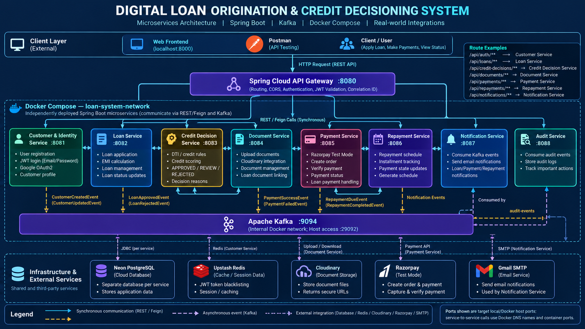
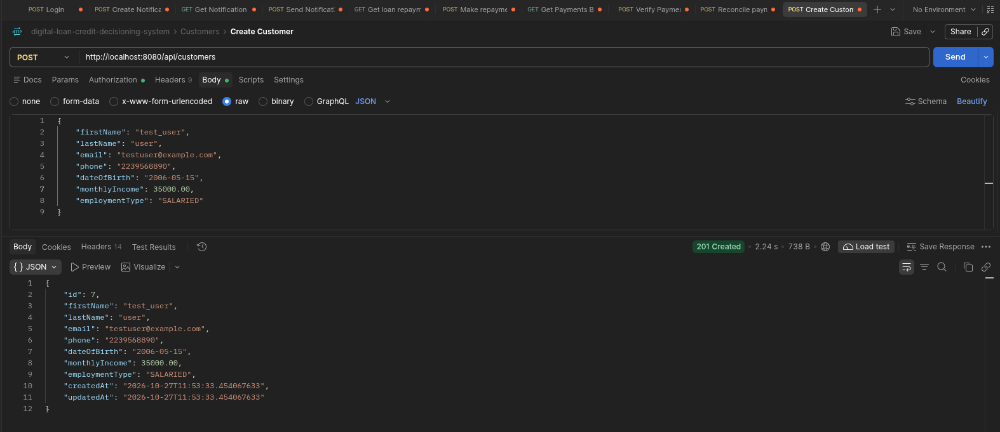
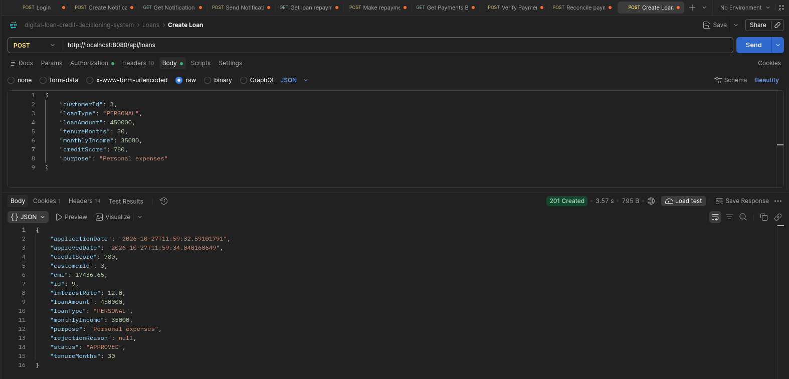
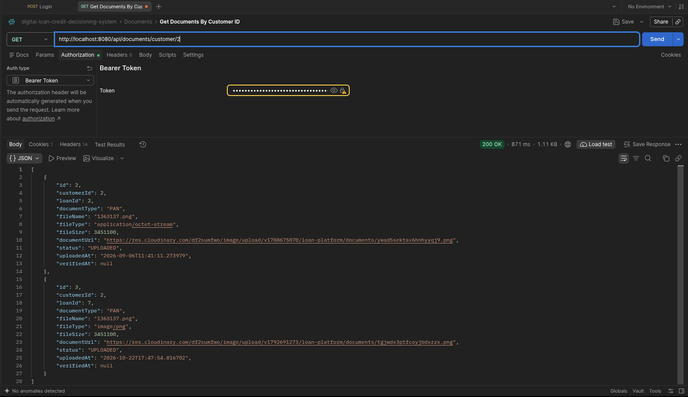
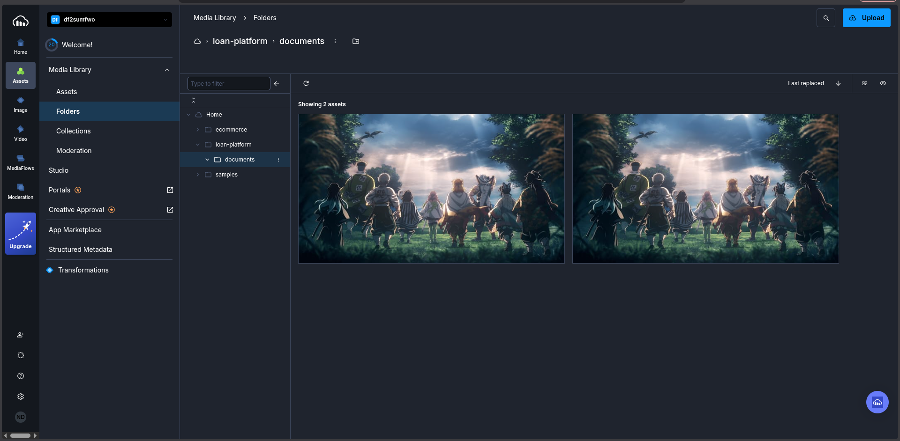
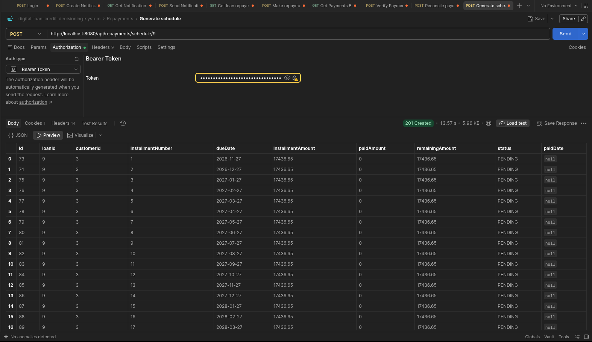
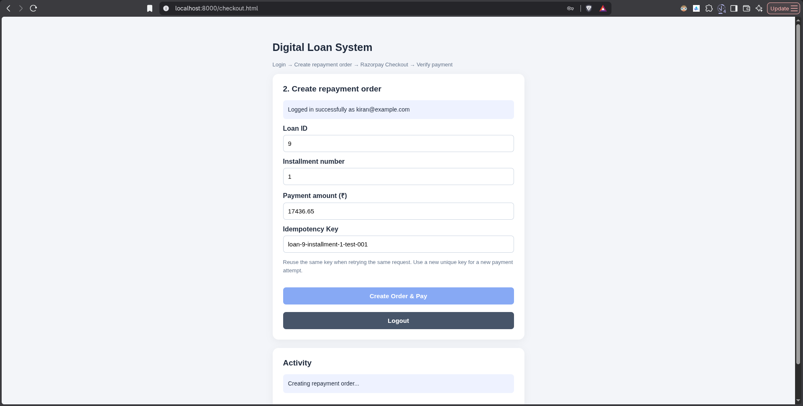
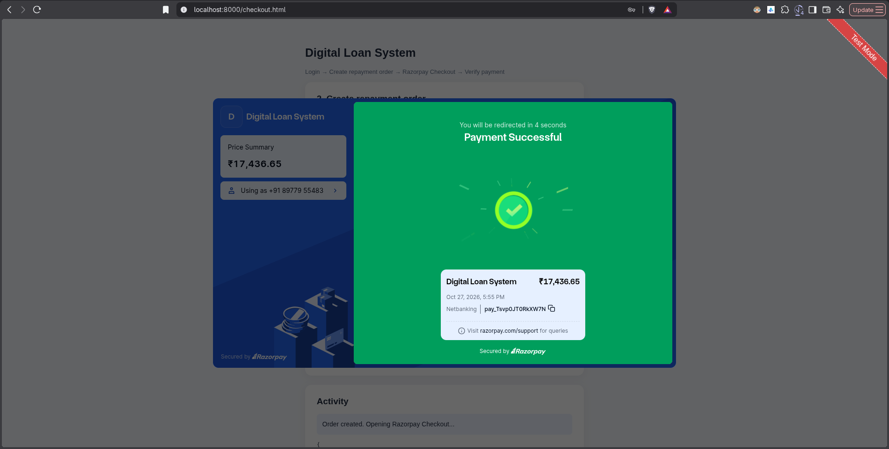
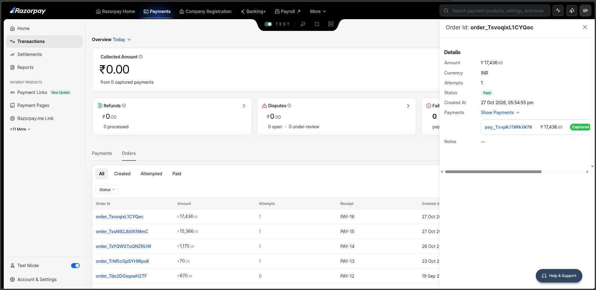
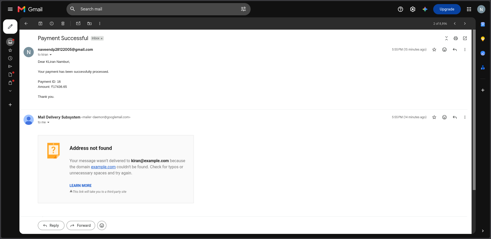

# Digital Loan Origination & Credit Decisioning System

<p align="center">
  
</p>

<p align="center">
  <strong>A microservices-based digital lending platform built with Java, Spring Boot, Spring Cloud Gateway, Apache Kafka, PostgreSQL, Redis, Docker, and Razorpay.</strong>
</p>

<p align="center">
  
  
  
  
  
  
</p>

## Overview

The **Digital Loan Origination & Credit Decisioning System** is a backend-focused lending platform designed to demonstrate how a digital loan lifecycle can be implemented using independently deployable Spring Boot microservices.

The system brings together customer management, loan origination, rule-based credit evaluation, document management, payment processing, repayment scheduling, notifications, and audit logging behind a centralized API Gateway.

It combines synchronous REST communication with asynchronous Kafka events and integrates external services for cloud database storage, document storage, caching, payments, and email delivery.

Rather than building a single monolithic application, this project separates responsibilities into dedicated services to demonstrate modular design, service-to-service communication, containerization, and distributed application development.

## Key Features

- **Customer and identity management** — Customer registration, login using email and password, JWT-based authentication, refresh tokens, and Google OAuth2 integration.
- **Loan origination** — Submit loan applications, validate customer information, calculate EMI and interest, and manage loan statuses.
- **Credit decisioning** — Evaluate applications using credit-score and debt-to-income (DTI) rules, producing `APPROVED`, `REVIEW`, or `REJECTED` decisions with reasons.
- **Document management** — Upload and retrieve loan documents using Cloudinary, with document metadata linked to customers and loans.
- **Payment processing** — Create Razorpay test-mode orders, verify payments, reconcile payment records, and integrate successful payments with repayment processing.
- **Repayment management** — Generate installment schedules, track installment amounts and statuses, and process repayment updates.
- **Event-driven notifications** — Use Kafka events to trigger payment, loan, and repayment-related notification workflows.
- **Email notifications** — Send transaction-related emails through Gmail SMTP.
- **Audit logging** — Publish and consume audit events to record important application activities.
- **API Gateway** — Centralize API routing, CORS configuration, JWT-related security integration, and request correlation.
- **Containerization** — Build and run the microservices and Kafka using Docker Compose.

## Technology Stack

| Area | Technologies |
|---|---|
| Language | Java |
| Backend framework | Spring Boot |
| API gateway | Spring Cloud Gateway |
| Security | Spring Security, JWT, refresh tokens, Google OAuth2 |
| Inter-service communication | REST APIs, OpenFeign |
| Event streaming | Apache Kafka |
| Database | PostgreSQL on Neon |
| Caching and session-related functionality | Redis |
| Document storage | Cloudinary |
| Payment integration | Razorpay Test Mode |
| Email | Gmail SMTP |
| Build tool | Maven |
| Containerization | Docker, Docker Compose |
| API testing | Postman |
| Frontend test interface | HTML, CSS, JavaScript-based Razorpay checkout page |

## Architecture

The platform uses a gateway-based microservices architecture. Clients access backend APIs through the API Gateway, which routes requests to the appropriate service. Services communicate synchronously through REST/Feign where immediate responses are needed and asynchronously through Kafka where event-driven processing is appropriate.

### High-level architecture

```text
                         CLIENTS
                    Frontend / Postman
                            |
                            v
                  +---------------------+
                  |  Spring Cloud       |
                  |  API Gateway :8080  |
                  +---------------------+
                            |
          +-----------------+------------------+
          |                 |                  |
          v                 v                  v
   +-------------+   +-------------+   +------------------+
   | Customer    |   | Loan        |   | Credit Decision  |
   | Service     |<->| Service     |-->| Service          |
   | :8081       |   | :8082       |   | :8083            |
   +-------------+   +-------------+   +------------------+
          |                 |                  |
          +-----------------+------------------+
                            |
                 +----------+-----------+
                 |                      |
                 v                      v
          +-------------+       +-------------+
          | Document    |       | Payment     |
          | Service     |       | Service     |
          | :8084       |       | :8085       |
          +-------------+       +-------------+
                                      |
                                      v
                               +-------------+
                               | Repayment   |
                               | Service     |
                               | :8086       |
                               +-------------+

             Kafka event communication
                         |
             +-----------+------------+
             |                        |
             v                        v
      +-------------+          +-------------+
      | Notification|          | Audit       |
      | Service     |          | Service     |
      | :8087       |          | :8088       |
      +-------------+          +-------------+

     External infrastructure and integrations:
     Neon PostgreSQL | Redis | Cloudinary
     Razorpay Test Mode | Gmail SMTP
```

The diagram above is a simplified conceptual view. The architecture image at the top shows the intended service connections and integration boundaries in more detail. Actual REST and Kafka dependencies are determined by the implementation and configuration.

### Microservices and responsibilities

| Service | Port | Responsibility |
|---|---:|---|
| API Gateway | 8080 | Route incoming API requests and apply gateway-level configuration |
| Customer Service | 8081 | Customer profiles, authentication, identity, and OAuth2 integration |
| Loan Service | 8082 | Loan applications, loan lifecycle, EMI calculations, and loan status |
| Credit Decision Service | 8083 | Credit evaluation, DTI rules, decisions, and decision reasons |
| Document Service | 8084 | Document metadata, upload/retrieval, and Cloudinary integration |
| Payment Service | 8085 | Payment orders, payment verification, reconciliation, and payment status |
| Repayment Service | 8086 | Repayment schedules, installments, and repayment state |
| Notification Service | 8087 | Consume relevant events and deliver email notifications |
| Audit Service | 8088 | Consume audit events and persist audit records |

### Communication patterns

**Synchronous communication**

REST APIs and OpenFeign are used for operations that require an immediate response, such as customer validation, loan-related operations, and payment-to-repayment integration.

**Asynchronous communication**

Apache Kafka provides event-driven communication for relevant loan, payment, notification, and audit workflows. This separates event producers from consumers and reduces the need for every operation to synchronously invoke every downstream service.

**External integrations**

- Neon PostgreSQL provides cloud-hosted relational database infrastructure.
- Redis supports configured caching and session-related functionality.
- Cloudinary stores uploaded document files and returns resource URLs.
- Razorpay Test Mode supports payment-order creation and payment testing.
- Gmail SMTP delivers notification emails.

## How the System Works

### 1. Customer registration and authentication

A customer registers or signs in using the authentication APIs. The system supports email/password authentication, JWT-based access tokens, refresh tokens, and Google OAuth2 integration.

Authenticated requests can then be sent through the API Gateway to the appropriate backend service.

<p align="center">
  
</p>

<p align="center">
  <em>Customer creation through the REST API.</em>
</p>

### 2. Loan application and credit decisioning

The customer submits a loan application containing information such as loan amount, tenure, monthly income, credit score, and loan purpose.

The Loan Service handles loan creation and financial calculations. The Credit Decision Service evaluates the application using the configured credit and debt-to-income rules.

The resulting decision is one of:

- `APPROVED` — the application satisfies the configured approval rules.
- `REVIEW` — the application requires further assessment under the configured rules.
- `REJECTED` — the application does not satisfy the configured eligibility rules.

The loan record is updated with the decision and relevant information.

<p align="center">
  
</p>

<p align="center">
  <em>Loan creation response showing the application details, EMI calculation, interest rate, and decision status.</em>
</p>

### 3. Document upload and retrieval

The Document Service manages document metadata and associations with customers and loans. Cloudinary provides the external storage for uploaded files.

This separation allows document metadata and document content to be managed by their respective components.

<p align="center">
  
</p>

<p align="center">
  <em>Retrieving customer-associated loan documents through the API.</em>
</p>

<p align="center">
  
</p>

<p align="center">
  <em>Uploaded document assets in the Cloudinary media library.</em>
</p>

### 4. Repayment schedule generation

The Repayment Service generates installment schedules for a loan and tracks information such as installment number, due date, installment amount, paid amount, remaining amount, and payment status.

This establishes the schedule against which repayment transactions can be processed and tracked.

<p align="center">
  
</p>

<p align="center">
  <em>Repayment schedule showing generated installments and their pending status.</em>
</p>

### 5. Payment processing with Razorpay

The payment workflow integrates the Payment Service with Razorpay Test Mode.

The checkout flow creates a repayment order, opens the Razorpay checkout interface, and verifies or reconciles the payment through the backend's configured payment-processing workflow.

The Payment Service maintains payment records and integrates with the Repayment Service to propagate successful payment outcomes.

<p align="center">
  
</p>

<p align="center">
  <em>Repayment checkout interface used to initiate a test payment.</em>
</p>

<p align="center">
  
</p>

<p align="center">
  <em>Successful Razorpay Test Mode checkout.</em>
</p>

<p align="center">
  
</p>

<p align="center">
  <em>Corresponding transaction visible in the Razorpay dashboard.</em>
</p>

> **Note:** The integration is demonstrated in Razorpay Test Mode. A successful checkout screenshot demonstrates the payment provider's checkout result; the backend payment record and repayment state should also be verified when testing end-to-end consistency.

### 6. Event-driven notifications

Relevant business events are published to Kafka and consumed by the configured consumers. The Notification Service processes applicable events, obtains required customer or loan information where configured, and sends email notifications through Gmail SMTP.

<p align="center">
  
</p>

<p align="center">
  <em>Payment-related email notification generated by the system.</em>
</p>

### 7. Audit event processing

The Audit Service consumes configured audit events and stores audit records. This provides a foundation for tracking important system activities and supporting operational investigation.

## API Testing

The backend APIs can be tested using Postman. The following examples use the API Gateway as the entry point.

**Base URL**

```text
http://localhost:8080
```

| Operation | Method | Endpoint |
|---|---|---|
| Customer registration | POST | `/api/customers` |
| Login | POST | `/api/auth/login` |
| Create a loan | POST | `/api/loans` |
| Retrieve customer documents | GET | `/api/documents/customer/{customerId}` |
| Generate a repayment schedule | POST | `/api/repayments/schedule/{loanId}` |

These are representative endpoints shown in the project testing workflow. Check the current controllers and security configuration for required request bodies, authorization, and any additional endpoints.

### Example: Login

```http
POST /api/auth/login
Content-Type: application/json
```

```json
{
  "email": "your-test-user@example.com",
  "password": "your-test-password"
}
```

Use test credentials from your own environment. Do not commit real passwords, access tokens, refresh tokens, or secrets to the repository.

## Running the Project Locally

### Prerequisites

Install or configure the following:

- Java version compatible with the project's Maven configuration.
- Maven.
- Docker and Docker Compose.
- Git.
- A Neon PostgreSQL database.
- Required credentials for Cloudinary, Razorpay Test Mode, Google OAuth2 (if testing OAuth), and Gmail SMTP.

### 1. Clone the repository

```bash
git clone https://github.com/naveendp2805/digital-loan-credit-decisioning-system.git

cd digital-loan-credit-decisioning-system
```

### 2. Configure environment variables

Each service has its own configuration and may use a service-specific `.env` file.

Populate the required variables using your own credentials. Depending on the service, these may include:

```dotenv
DB_URL=your_neon_jdbc_url
DB_USERNAME=your_database_username
DB_PASSWORD=your_database_password

JWT_SECRET=your_secure_jwt_secret

KAFKA_BOOTSTRAP_SERVERS=kafka:9094
```

Configure the remaining service-specific variables for Redis, Google OAuth2, Cloudinary, Razorpay, and Gmail SMTP as required by the application.

The values above are examples of variable names, not ready-to-use credentials. Check each service's `application.yaml`, `.env` requirements, and Docker Compose configuration before starting the system.

**Never commit populated `.env` files or real credentials.** Keep only safe environment-variable templates in Git.

### 3. Start the backend

Navigate to the backend directory:

```bash
cd backend
```

Validate the Docker Compose configuration:

```bash
docker compose config -q
```

Build and start the configured services:

```bash
docker compose up -d --build
```

Check container status:

```bash
docker compose ps
```

Inspect service logs when troubleshooting:

```bash
docker compose logs --tail=100 api-gateway
```

To inspect all services:

```bash
docker compose logs --tail=50
```

### 4. Verify the API Gateway

If the Gateway's health endpoint is exposed in your configuration, test it with:

```bash
curl -i http://localhost:8080/actuator/health
```

A healthy response should report `UP`. If the endpoint is not exposed, use the configured health endpoint or inspect the application logs.

### 5. Test the APIs

Open Postman and send requests to the Gateway at `http://localhost:8080`. Authenticate first where required, then test customer, loan, document, repayment, and payment workflows using valid test data.

The frontend checkout test page is available in the repository under `frontend/razorpay-checkout/`. Follow the launch script and any instructions in that directory to run it.

## Project Structure

```text
digital-loan-credit-decisioning-system/
├── backend/
│   ├── api-gateway/
│   ├── customer-service/
│   ├── loan-service/
│   ├── credit-decision-service/
│   ├── document-service/
│   ├── payment-service/
│   ├── repayment-service/
│   ├── notification-service/
│   ├── audit-service/
│   └── docker-compose.yml
├── frontend/
│   └── razorpay-checkout/
│       ├── checkout.html
│       └── run-razorpay-checkout.sh
├── images/
│   ├── architecture.png
│   ├── login.png
│   ├── customer-creation.png
│   ├── loan-creation.png
│   ├── document-retrieval.png
│   ├── cloudinary-documents.png
│   ├── repayment-schedule.png
│   ├── payment-checkout.png
│   ├── payment-success.png
│   ├── razorpay-dashboard.png
│   └── payment-email.png
├── .gitignore
└── README.md
```

## Engineering Highlights

This project demonstrates practical backend engineering concepts:

- **Microservice decomposition:** Separating lending responsibilities into independent Spring Boot applications.
- **API gateway pattern:** Providing a common entry point for backend APIs.
- **Authentication and authorization:** Integrating Spring Security, JWT, refresh tokens, and Google OAuth2.
- **Distributed communication:** Combining REST/Feign calls with Kafka-based event processing.
- **Financial business logic:** Implementing loan EMI calculations, credit rules, repayment schedules, and payment-state transitions.
- **External service integration:** Connecting cloud database, document storage, payment, caching, and email services.
- **Containerized deployment:** Building and orchestrating the backend using Docker Compose.
- **Operational traceability:** Introducing correlation IDs and event-based audit logging.

## Future Improvements

Potential next steps for hardening the platform include:

- Add comprehensive unit, integration, and end-to-end tests.
- Add database migrations and stronger schema/version management.
- Harden payment webhook validation, idempotency, retries, and reconciliation.
- Improve Kafka retry policies, dead-letter handling, and consumer observability.
- Add centralized metrics, tracing, dashboards, and structured logging.
- Strengthen secrets management, rate limiting, and production security.
- Introduce CI/CD and deploy the services to a cloud or Kubernetes environment.
- Build a full customer-facing frontend and test the complete user journey through the Gateway.

These are improvement areas, not claims that the corresponding production features are already complete.

## Author

**Naveen**

GitHub: [@naveendp2805](https://github.com/naveendp2805)

Repository: [Digital Loan Origination & Credit Decisioning System](https://github.com/naveendp2805/digital-loan-credit-decisioning-system)

---

<p align="center">
  <em>Built to explore microservices, secure API design, credit decisioning, event-driven systems, and payment integration using Java and Spring Boot.</em>
</p>
